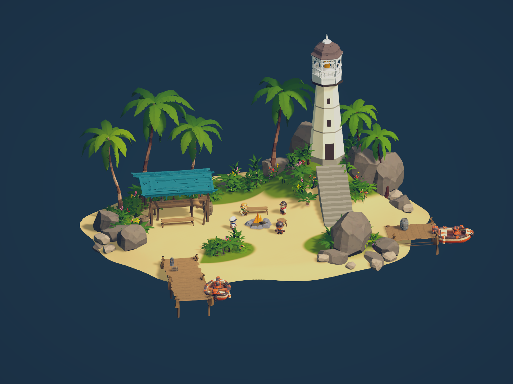
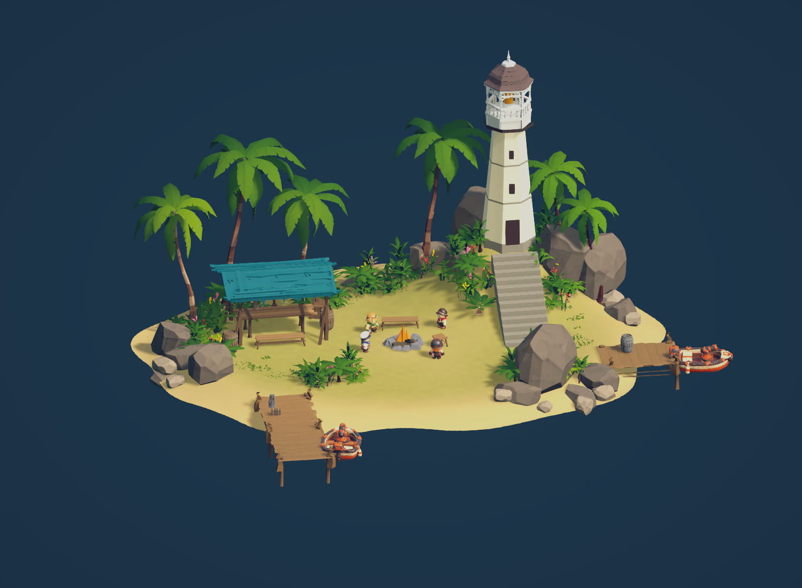
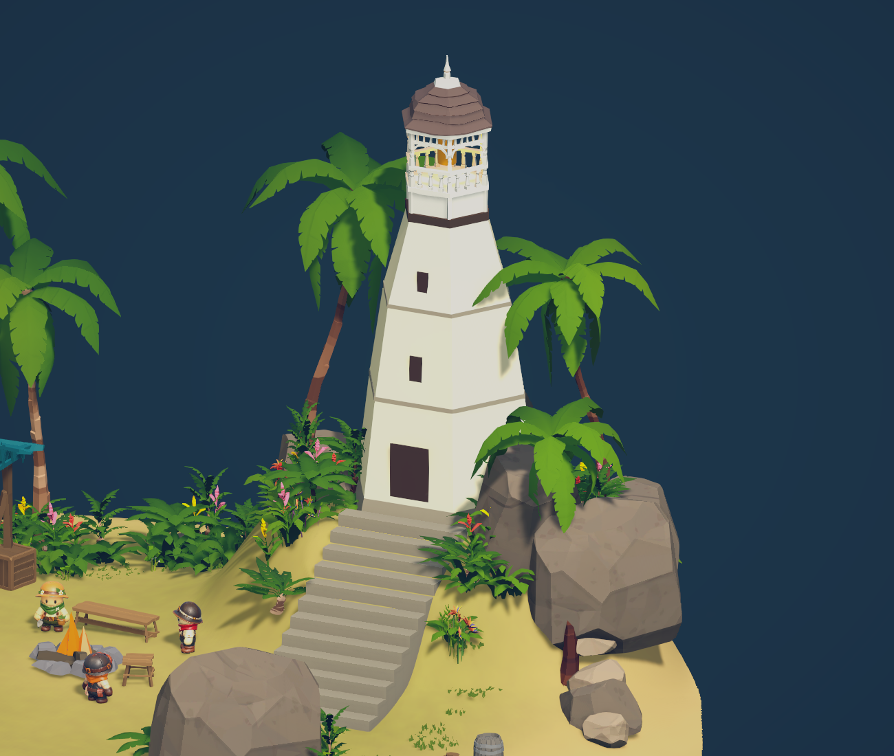
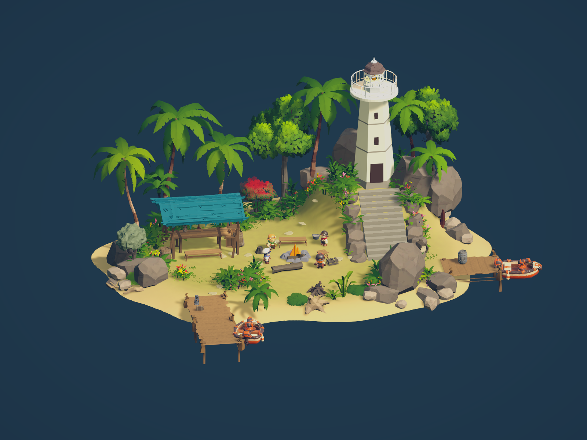
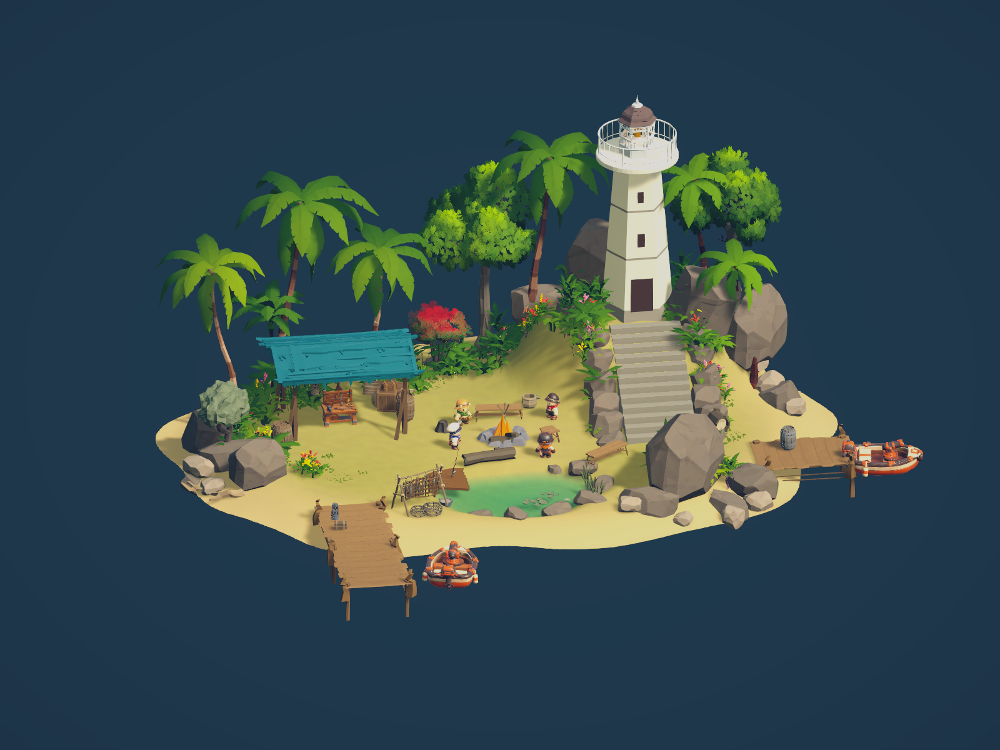
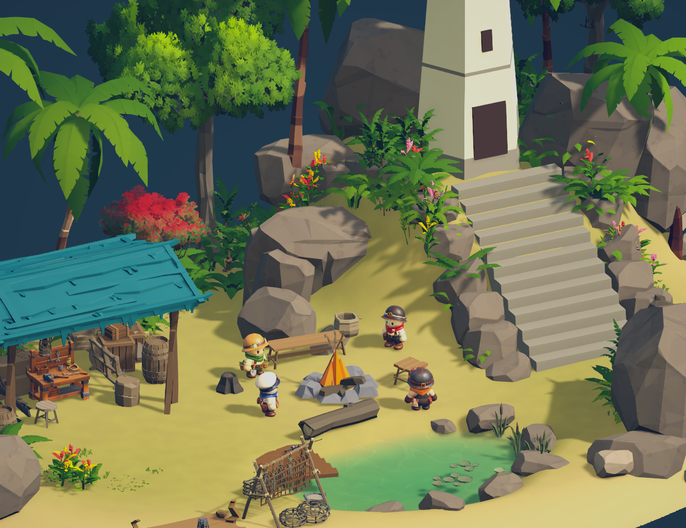

# LighthouseReference 등대·작업장 섬 제작
작성자: 강민서 작업 영역
작성일·갱신일: 2026-10-28
상태: 구현됨(에디터 시각·저장 검증, Play 미검증)
브랜치·기준 커밋: feature/minseo / 7c48d7a2

## 요청과 목표
LagoonReference의 기존 네 섬을 보존하고 첨부 이미지의 등대·작업장·광장·부두 섬을 추가. 물·하늘 제외. 등대는 두 번째 이미지의 Pirates 첨탑과 별도 하단 메시. 플레이어·보트 원본 scale 보존.

## 진행 과정과 결정 이유
- 기존 작업 pointer·PalmReference 기록, 씬·에셋 안전·소유권·검증 기준을 읽고 현재 에디터 씬을 확인. 기존 미커밋 변경은 보존했다.
- v4 섬 외형 제작과 연결되는 씬 작업으로 한정했다. N08 파도/물리 계약은 대장상 계약 확인 필요이며 이번 작업에서 해결하지 않았다. 등대 기능·모듈·네트워크·월드 생성 등록을 추가하지 않았다.
- Unity CLI 1.0.0-beta.14 최신 확인. MCP eval로 기존 씬 백업과 Transform 기준 2,180개를 저장.
- 새 루트 LighthouseIsland_Reference를 (34,0,0)에 배치. TerrainData 1025 높이맵/holes1024, Terrain 영역 27.2×22.4m, 비대칭 타원 해안·오른쪽 언덕 생성.
- Jungle 야자수·고사리·넓은 잎 식생·바위, Nature 꽃, Pirates 청록 지붕·기둥·작업대·상자·통·모닥불·목재 부두를 개별 조정. 환경 비율 조정 중 지형/배치 좌표는 축소했으나 배우 프리팹 scale은 유지했고 각 에셋 크기는 종류·개체별로 보정했다.
- SM_Bld_Mansion_Tower_01 원본 프리팹으로 흰 난간·갈색 첨탑을 배치. 하단은 8각 테이퍼 메시 3단과 띠·기단·문·창, 계단으로 구성.
- Jungle Demo_Day를 에디터에서 추가 로드해 Volume 구성 확인 후 닫았다. 독립 프로필/재질 복제 후 Bloom·색 보정·Synty/Foliage 색 설정. 외부 원본은 수정하지 않았다.
- 모닥불은 Pirates FX와 에디터에서도 보이는 저장된 불꽃 메시를 함께 사용했다. Nature 꽃은 원본 메시를 복제하여 상단/줄기 삼각형 재질을 분리하고 분홍·노랑·산호색으로 보정했다.
- 전체/작업장 근접/등대 근접/후면 MCP 실제 렌더를 반복 확인. 갈색 잎, 가는 기둥, 불필요한 관목, 부두 형태·높이, 묻힌 문/창 등을 수정했다.
- 사용자 후속 요청: “쥐파먹은 잔디” 수정. 노이즈 기반 잘게 끊긴 잔디를 폐기하고 식생 아래 넓게 이어지는 Terrain 레이어로 재도색. 광장·작업장·부두 접근로는 모래로 두고 앞쪽 잔디 조각도 제거.
- eval 초기 네임스페이스 오류는 실행 전 수정. Volume 복제 중 원본 하위 에셋 추가 실패 1건은 각 컴포넌트 독립 복제로 수정. 최종 프로필 하위 컴포넌트 경로 전부 신규 프로필 소속 확인.

## 변경 파일과 결과
- Assets/00.Scenes/Minseo/LagoonReference.unity 및 기존 meta
- Assets/00.Scenes/Minseo/LagoonReference_BeforeLighthouse_20261028.unity 및 meta: 작업 전 백업
- Assets/00.Scenes/Minseo/LighthouseReference/ 및 meta: TerrainData·TerrainLayer·텍스처·메시·복제 재질·VolumeProfile
- 이 기록, 담당자 POINTER.md
- [최종 실제 렌더](LighthouseReference/01-final.png), [기존 Transform 기준](LighthouseReference/before.txt)
- 프로젝트 C# 파일/런타임 생성 스크립트는 추가하지 않음. 커밋·푸시 없음. 대상 씬은 작업 전부터 미추적 상태.

## 실제 검증
- 저장 후 씬 재열기 dirty=false.
- 기존 루트 Transform 2,180개 GlobalObjectId·local position/rotation/scale 비교: 변경 0.
- 신규 Terrain 영역 X20.4~47.6, Z-11.2~11.2. 기존 라군 X-8.4~8.4/Z-7.2~7.2, 광석 X57.5~72.5/Z13.5~26.5, 샘터 X92.25~107.75/Z13.18~26.82, 야자수 X26.52~41.48/Z39.24~48.76과 비중첩.
- captain/farm/tanker/tech 4개 scale (1,1,1), Boat 2개 scale (3,3,3). 실제 원본 프리팹 scale과 전부 일치.
- 씬 전체 Missing Script 0. 신규 루트 null material/오류 shader 0. ParticleSystemRenderer의 비어 있던 trail material은 해당 인스턴스에만 채웠다.
- scriptCompilationFailed=false. 과거 콘솔 오류와 이번 Volume 복제 시도 오류는 콘솔에 남겼으며 콘솔 전체 오류 0을 주장하지 않는다.
- 최종 화면은 에디터 카메라 오프스크린 렌더. Play 실행 증거가 아니다.

## 남은 차이·미검증
- 참고 이미지와 완전히 동일하다는 판정은 하지 않았다. 실제 원본 배우 외형, Synty 야자수·암석 형태, 식생 밀도·광원 및 지형 세부에 차이가 남는다.
- 실제 입력 보행/계단/접안/부력·4인 네트워크·GPU 성능·빌드는 실행하지 않았다. 물을 제외했으므로 부력 동작 검증 대상도 구성하지 않았다.
- 등대와 작업장은 외형이며 기존 게임 기능과 연결하지 않았다.
- 사용자가 요청한 잔디 구멍/얼룩 제거는 반영하고 저장·재열기 화면을 확인했다.

## 후속: 잔디 경계·내부 전반 재도색

2026-10-28 사용자 요청으로 원형 녹지의 선명한 경계와 잘게 끊긴 형태를 제거했다. 앞쪽 식생 17개를 작업장 쪽으로 개별 이동·회전·크기 조정하고, Jungle 짧은 풀 36개를 개별 크기와 방향으로 추가했다. 이어진 사용자 결정인 ‘흐릿한 버전으로 섬 내부에 전체적으로’에 따라 Terrain 알파맵을 다시 칠해 내부 전반에 옅고 연속적인 잔디층을 적용했다. 중앙 광장도 얇은 녹지를 유지하고, 해안으로 갈수록 넓은 전이 폭으로 모래에 섞인다. 낮은 주파수의 미세 색 변화만 두어 구멍·작은 얼룩이 생기지 않도록 했다.

MCP 전체·근접 렌더 확인 후 저장·재열기 dirty=false. 이번 수정 직전 외부 오브젝트와 배우 루트 Transform 2,186개 비교 변경0. Missing Script·null/오류 재질0(직전 검사), Play는 미실행. 사용자 편집으로 이미 dirty였던 시작 씬 상태를 보존하며 해당 섬 잔디·식생만 수정했다. 추가 재질 Fringe_Grass 및 기존 MossGrass 텍스처/TerrainData, 씬과 기록을 갱신했다.

## 후속: 등대 하단 확장·육각 면 정렬·첨탑 축소

2026-10-28 사용자 요청으로 하단 구조물을 넓히고 상단 Pirates 첨탑의 면에 맞췄다. 실제 첨탑 밑면 정점을 조사해 육각 구조를 확인했으며, 기존 8각 하단 메시를 6각으로 재구성했다. 기단 X축 전체 폭은 약2.64m에서4.04m로 확장했고, 몸통 각 단의 폭·띠·문/창 위치도 개별 보정했다. 최상단 몸통 메시와 첨탑 밑면 접합 높이는 둘 다 로컬 Y9.4875다.

지지 Terrain은 중심(5.6,3.84) 주변의 넓은 지반과 완만한 사면으로 확장했다. 기단 6개 모서리 지면 높이는 약3.47995m로 기단 바닥3.45m보다 높아 접지된다. 언덕 영향권 밖에 높이 변화가 퍼진 중간 시도를 확인하고 기존 생성 높이식으로 재계산해 타원 영향권(반경 X5/Z4.5) 안으로 제한·경계 보간했다. 계단 폭2.12→2.55m, 계단 주변 높이 보정과 해당 영역 식생/암석94개 재접지, 계단 통로 식생9개 개별 이동을 적용했다. 섬 Terrain 전체 크기와 해안 holes는 유지했다.

추가 사용자 사진 요청에 따라 Pirates 첨탑 전체 크기를 기존의82%로 줄였다(현재 scale0.51168/0.39975/0.51168, 렌더 메시 폭약1.934m·높이약3.018m). 첨탑 크기에 맞춰 바로 아래 몸통 상단 폭약1.644m·코니스·등불·상단 창 위치를 동반 보정했고 육각 방향을 유지했다.

MCP 전체·근접 화면 반복 확인, 저장·재열기 dirty=false. 기존 섬/공용 루트 Transform2,180개 변경0. Play 보행·접안·4인 미검증. 프로젝트 C#·원본 프리팹 변경 없음.

## 후속: 완만한 몸통·전망대·식생 다양화·계단과 광장 마감

2026-10-28 이어서 작업. 하단 몸통 밑폭2.56m/윗폭1.644m, 세 구간 동일 기울기 약0.08252로 꺾임 제거, 문/창 표면 경사 보정. 첨탑은 앞선 값의75%로 추가 축소하고 원형 전망대(폭2.98m·흰 난간30개·손잡이/하단 레일·확장 받침)를 별도 메시로 추가했다.

Jungle/Nature 식생114개·22종을 Flora_ColourAndVariety에 배치하고 꽃·붉은 수관·관목·고사리로 보완했다. 사용자 추가 지적에 따라 큰 수관 나무·바나나·낮은 야자·유목·그루터기·버섯을 추가했다. 중단 후 재개 시 저장 씬에 직전 Flora_LandmarkGroves/광장 미저장 그룹이 없음을 확인했으며, 현재 씬에 필요한 주요 군락과 소품을 PlazaAndStair_NaturalEdges 그룹으로 재구성했다.

계단 양옆 지면에 묻힌 바위12개와 고사리6개로 떠 보이던 측면을 가리고, 광장에 낮은 돌길16개·통나무 좌석·그루터기 좌석·보급 상자/포대·물통/바구니를 배치했다. 새 그룹68개. 모닥불 주변·계단 중앙 통로는 시각적으로 남겼다. 바위와 식생 개별 위치·회전·비율을 적용했으며 기존 배우 scale은 유지했다.

MCP 전체와 계단 양쪽/광장/전망대 근접 화면 반복 확인. 저장 후 재열기 dirty=false, 기존 외부 Transform2180개 변경0, 씬 Missing Script0·새 섬 불량재질0. 실제 입력 보행·충돌/접안·4인·GPU 성능은 미검증. 변경 파일은 대상 씬, LighthouseReference 메시·독립재질과 이 기록·pointer. 커밋/푸시 없음.

## 후속: 연못과 생활 광장·담당자 작업대

2026-10-28 사용자 요청으로 흩뿌린 식생 중심의 광장을 연못·낚시·조리·작업장 보급 공간으로 재구성했다. Synty Pirates 낚싯대·통발·조리냄비, Vikings 생선건조대·그물, Adventure 수레·바구니·냄비의 실제 프리팹과 메시 크기를 조사했다. 이전 마감그룹37개와 연못 위치의 산발적인 식생을 비활성화해 원본 배치를 보존했다. 계단 옆 바위/고사리는 유지했다.

Terrain 높이맵을 국소 수정해 중심(-0.1,-4.8), 약6.4×4.2m의 비정형 얕은 연못을 만들었다. 수면Y0.48, 바닥 약0.13~0.25m, 주변 지형으로 완만하게 연결. 기존 샘터 섬 SpringWater_Clear 재질을 독립 복제하고 신규 수면 메시를 저장했다. 연못 가장자리 바위7개·갈대5개·수련3개, 짧은 목재발판6개·낚싯대·생선건조대/그물·통발을 기능별로 모았다. 모닥불에 조리냄비, 작업장 측면에 수레/상자/포대, 연못 옆에 벤치를 배치했다.

작업대 조사: Assets/02.Prefabs/Lighthouse/Workbench.prefab은 기능은 있으나 기본 Cube 모델이었다. 담당자 WorkbenchModelSetup.cs를 읽고 JH04TestScene/MainGame을 추가 로드하여 실제 모델 적용 인스턴스를 확인했다. JH04TestScene의 모델 적용 Workbench 인스턴스를 복제해 LighthouseReference/Workbench_ModelConfigured.prefab으로 저장·배치했다. NetworkIdentity·InteractionTarget·WorkbenchNet·WorkbenchRack과 wooden_workbench_3d_model_low 메시/재질/충돌체 구성을 보존했고 외부 씬 Component 참조0을 확인했다. 담당자 씬은 저장하지 않았고 원본 프리팹은 수정하지 않았다. 기존 임시 Synty 작업대는 비활성화, 앞 장식 벤치는 연못가로 이동.

MCP 전체·작업대/연못 근접 실제 렌더 확인. 저장·재열기 dirty=false, 기존 외부 Transform2180개 변경0, Missing Script0·오류/빈 재질0. 작업대는 기능 컴포넌트와 모델이 연결된 배치이며, 이 참고 씬에서 실제 상호작용/제작·네트워크 작동은 미검증이다. 연못 보행/충돌·수면 런타임/4인·GPU도 미검증. 기존 물·하늘 제외 요청은 이번 사용자의 연못 요청 범위에서 국소 수면 추가로 변경 적용했다.

변경: LagoonReference.unity, 작업 전 BeforePondPlaza 백업, LighthouseReference TerrainData·수면 메시/재질·작업대 로컬 프리팹·목재재질, 이 기록과 pointer.

## 후속: 연못 빛 그물 크기 확대
2026-10-28 사용자 요청으로 촘촘한 바닥 타일처럼 보이던 코스틱을 수정. SpringWater.shader를 연못 전용 CourtyardPondWater.shader로 복제해 기존 샘터는 보존했다. _Caustic_Scale을0.4→0.14로 줄여 무늬 간격 약2.86배 확대, 큰 저주파 좌표 왜곡을 더해 불규칙하게 휘어지는 빛 그물로 조정. _Caustic_Scale 재질 속성으로 재조정 가능. MCP 연못 근접 실제 렌더 확인·저장 완료, Play 움직임은 미검증. 도구 timeout1회가 있었으나 후속 화면/재질로 적용 확인.

## 후속: 낚싯대 받침·작업장 생활감·사면 약초밭
2026-10-28 사용자 삭제 벤치가 없는 dirty 씬을 시작 상태로 보존했다. 작업 전 BeforeLivedIn 백업. Pirates/Vikings/Adventure의 랙·받침·말뚝·공구와 모델 경계를 조사: 전용 낚싯대 거치대는 확인하지 못해 신규 원기둥 조합으로 두 V자 받침을 만들었다. 낚싯대 로컬 축 두 접촉점을 계산해 받침 높이를 맞추고 목재 발판 위에 접지, 근접 렌더에서 양 받침 접촉 확인.
기능 작업대는 원본 구성/scale 유지. 주변에 Adventure 보조 작업판, Vikings 공구랙·망치·모루 받침·로프, Pirates 의자, Nature 적재 통나무4개를 추가해 작업장 용도로 구성. 등대 왼쪽 사면에 지면을 따르는 토양 메시2개·돌테두리14개·약초10개를 배치했다. 새 Courtyard_DailyWork42개. 관리 구역을 만들고 계단 길목 벤치는 복원하지 않았다. 사용자 기존 모닥불 FX 변경을 보존했다.
전체/낚싯대 근접 실제 MCP 렌더 확인, 저장·재열기 dirty=false, 외부 Transform2180개 변경0. 실제 작업대/보행·4인 미검증. 변경: 씬·HerbBed 메시/재질·원기둥 받침 및 배치/기록/pointer, 원본 프리팹 변경 없음.

## 후속: 사면 텃밭 제거·자연 암반 가림
2026-10-28 사용자 지적으로 텃밭 흙판2·작물10·돌테두리14를 모두 비활성화했다. 사용자가 추가 편집한 dirty 씬 상태를 보존했다. Jungle Rock_Cliff01/02·Rock02/03·Rock_Pile04로 큰 암반6개를 크기/회전/깊이를 달리해 배치하고 고사리1개로 틈을 연결했다. Lighthouse_NaturalRockFace7개. 기단/계단 기존 암반과 작업장 뒤쪽을 잇는 노출 기반암 형태를 목표로 양쪽 근접 MCP 렌더 보정. Terrain 전체/해안과 작업대 기능은 수정하지 않았다.
저장·재열기 dirty=false 확인, 외부 Transform2180개 변경0. 보행/충돌·4인 미검증. 변경은 씬 배치·기록/pointer/캡처이며 신규 외부 에셋/원본 프리팹 수정 없음.

## 2026-10-29 기능별 커밋 정리
런타임 코드·외형 에셋·연결을 기능별로 분리해 로컬 커밋했다. 참고 원본 씬과 백업은 이전 작업이 섞여 있어 이번 커밋에서 제외했다. 기존 본문의 미커밋·미연결 표기는 해당 작업 시점의 기록이며, 최신 커밋 범위와 후속 검증은 [커밋 정리](../2026-10-29/야간작업-기능별-커밋정리.md)를 따른다. push와 추가 Play 시험은 하지 않았다.
