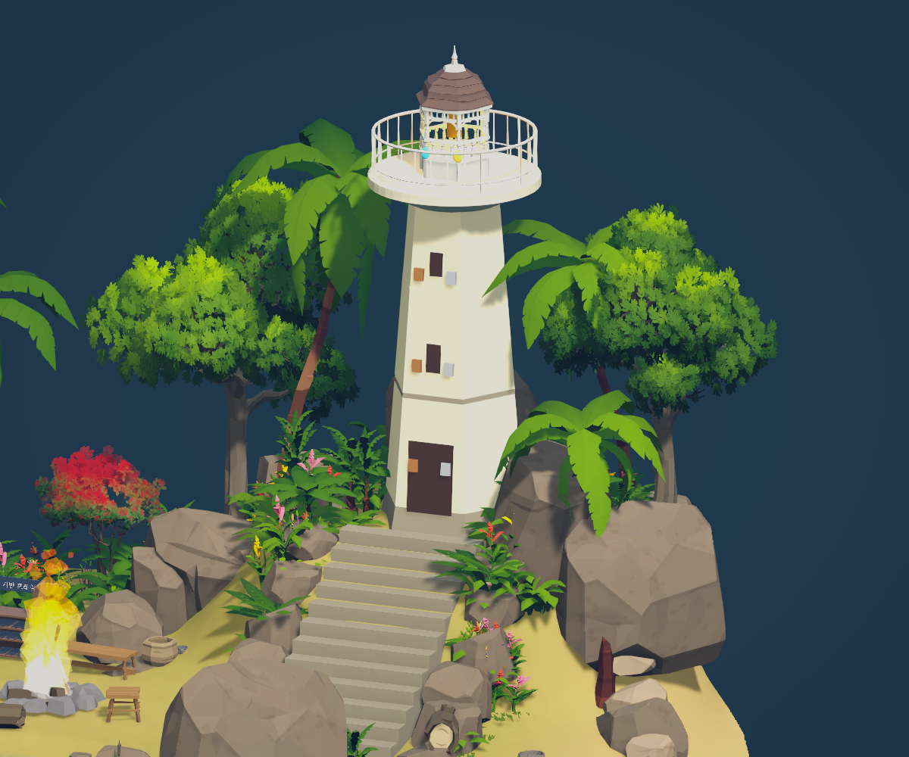

# 새 메인 등대섬 시스템 연결
작성일: 2026-10-29
상태: 연결됨·임시 서버 장착 검증, 통합 검증 대기

## 대상과 사용자 의도 확인
대상은 Assets/00.Scenes/Minseo/LagoonReference.unity 안 LighthouseIsland_Reference의 조립식 등대다. LagoonIsland_Reference에는 붙이지 않았다. MainGame 파일 SHA256은 작업 전과 동일하고 어느 섬도 추가하지 않았다. 두 씬을 조사 중 추가 로드해 함께 보인 상태가 있었으며 현재는 LagoonReference만 남겼다. 최종 교체/기존 MainGame 등대 삭제는 이번 작업에서 수행하지 않았다.

## 연결
LighthouseIsland_Reference/Lighthouse에 MainGame Lighthouse의 NetworkIdentity·InteractionTarget·TowerNet·TowerView·TowerMatchNet·TowerMatchFlow 복제. 루트는 섬 로컬(5.6,3.9375,3.84), 상호작용 범위3.5m 원본 유지. 원본 시험용 몸통 큐브/Beam은 제거, 기존 조립식 메시와 충돌체는 보존. 슬롯8개 표시를 새 몸통/등실 높이에 배치하고 완료 표시는 기존 Lighthouse_GoldenLantern에 연결. TowerNet.Workbench는 Workbench_Functional로 재연결.
Lighthouse_IntegrationSupport에 ModuleInteractionHandler·Voting·TowerScreen_Sketch·FinalBattleHud·WorkbenchScreen_Wood를 복제하고 씬 참조를 전부 재매핑했다. 이 지원 구성은 LagoonReference에서 연결을 보존하기 위한 것이다. 나중에 MainGame으로 통합할 때 기존 모듈 처리기/투표/UI를 재사용하고 중복 시스템을 남기지 않아야 한다. MainGame 기존 소비자 TowerScreen/FinalBattleHud/DevTowerTools 참조도 새 등대로 전환해야 한다. Island 전체 프리팹/MapGeneration 프로필 대체는 후속이다.

## 설계 대조
MainGame 현재 Layout은 시험값 TowerLayout_JH04Trial(1/2/3층+등실,8슬롯), 설정 TowerBattleSettings_JH04Trial이다. 규칙을 새로 확정하지 않고 동일 데이터 참조를 유지했다. 문서의 3층 구조·문제대장 V11/W01/R08/R10의 남은 계약을 해결한 것으로 보지 않는다. TowerMatchNet 코드의 기존 최후전투 수리승계와 승패 문서 차이는 이번 이식 범위에서 바꾸지 않았다.

## 검증
레이아웃/전투설정 Validate 오류없음, 새 섬 전체 외부 씬 참조0. Mirror OnValidate로 새3개 NetworkIdentity sceneId 재발급. 임시 Play에서 frameCount913→921 관찰. 실제 Telepathy 서버(임시 포트17931)를 시작하고 작업대/모듈처리기/투표/등대를 Spawn, 서버API로 운반→설치8/8 성공·설치수8·수리100%·완성true·슬롯표시8/8·완료등불true 확인. 빈손 추가 장착false. 이는 기존 모듈을 장부에 생성해 운반 API로 넣은 시험으로, 자원제작/UI 입력·원격 동기화 시험이 아니다.
시험 중 새 오류0. 기존 참고섬 PlayerInput 장치 경고·Terrain 이웃 해상도 경고가 있었고, LagoonReference에는 GameClock이 없어 TowerMatchFlow가 일수/마감 없음 경고를 냈다. 임시 서버Shutdown·Play종료·표시용 배우6개 active 상태/참고카메라 enabled 복원 후 저장. 실제 플레이어 접근/E/F입력·의식/소환/승패·4인·월드생성 통합은 미검증.

## 변경
LagoonReference.unity, BeforeTowerSystem_20261029 백업과 meta, 본 기록·담당자pointer·검증증거. 원본 MainGame/공유코드/프리팹 수정·커밋·푸시 없음.

[서버 결과](LighthouseSystem/server-verification.txt)

## 2026-10-29 기능별 커밋 정리
런타임 코드·외형 에셋·연결을 기능별로 분리해 로컬 커밋했다. 참고 원본 씬과 백업은 이전 작업이 섞여 있어 이번 커밋에서 제외했다. 기존 본문의 미커밋·미연결 표기는 해당 작업 시점의 기록이며, 최신 커밋 범위와 후속 검증은 [커밋 정리](야간작업-기능별-커밋정리.md)를 따른다. push와 추가 Play 시험은 하지 않았다.
